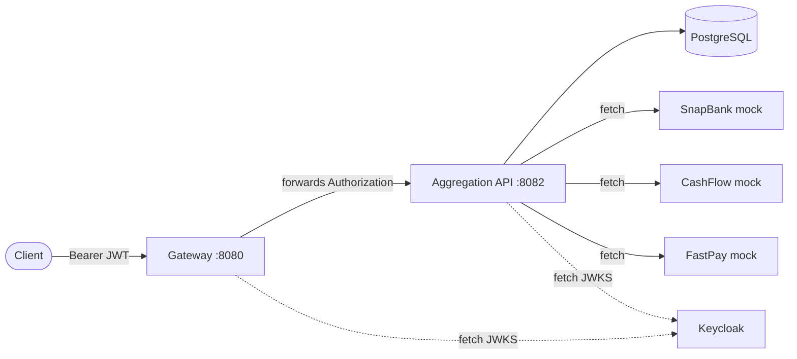

# Transaction Aggregation Platform

A small platform that pulls a customer's transactions from several banking providers, normalises and categorises them, stores them in PostgreSQL, and exposes a query and summary API. Requests enter through an API gateway that authenticates the caller with a JWT; the aggregation service validates the same token independently.

| Module | Port | Responsibility |
|---|---|---|
| `gateway` | 8080 | Spring Cloud Gateway. Validates JWTs and routes `/api/v1/transactions/**` to the aggregation service. |
| `transaction-aggregation` | 8082 | Spring Boot API. Fetches provider data concurrently, upserts transactions, serves queries and summaries. Owns the schema (Flyway). |
| Postgres 17 | 5432 (localhost only) | Storage. |
| Keycloak 26 | 8180 (localhost only) | Local identity provider with a pre-seeded realm, used to issue test tokens. |



## Prerequisites

- Docker with Compose v2 (to run the full stack and the integration tests)
- For running outside Docker: JDK 21+ and the included Maven wrapper (`./mvnw`)

## Quick start

```bash
cp .env.example .env          # then set real values for the passwords
docker compose up --build
```

If your network intercepts TLS (for example Zscaler), the Maven stage inside the image cannot download dependencies. Point `CORP_CA_PEM` in `.env` at your corporate root certificate (PEM). It is passed to the build as a BuildKit secret, imported into the build JDK's trust store, and never written into an image layer. Leave it unset everywhere else.

Wait for the `aggregation` service to log `Started TransactionAggregationApiApplication`, then:

```bash
# 1. Get an access token for the seeded user "alice" (dev realm only)
TOKEN=$(curl -s -X POST http://localhost:8180/realms/transaction-platform/protocol/openid-connect/token \
  -d grant_type=password -d client_id=transaction-platform-client \
  -d username=alice -d password=alice-password | jq -r .access_token)

# 2. Pull and store Alice's transactions from all providers
curl -s -X POST http://localhost:8080/api/v1/transactions/aggregate \
  -H "Authorization: Bearer $TOKEN" -H "Idempotency-Key: $(uuidgen)" | jq

# 3. List them
curl -s "http://localhost:8080/api/v1/transactions?pageSize=5&sortBy=amount&sortDirection=DESC" \
  -H "Authorization: Bearer $TOKEN" | jq

# 4. Summary by category
curl -s "http://localhost:8080/api/v1/transactions/summary/by-category" \
  -H "Authorization: Bearer $TOKEN" | jq
```

Swagger UI is available at <http://localhost:8082/swagger-ui.html> when the aggregation service is reachable directly (for example by running it locally).

Stop the stack with `docker compose down`; add `-v` to also delete the database volume.

## Building

Build both modules and run the test suite:

```bash
./mvnw verify                          # compile, test, package
./mvnw -pl transaction-aggregation -am package -DskipTests
```

Images are built by Compose from `Dockerfile.gateway` and `Dockerfile.aggregation`. Both are multi-stage: a Maven stage produces the fat jar, and a JRE 21 stage runs it as a non-root user. Maven dependencies are cached between builds with a BuildKit cache mount.

## Running tests

```bash
./mvnw verify
```

- `transaction-aggregation` unit tests (`*ServiceTest`, 49 tests) cover the aggregation, idempotency, categorisation and identity logic in isolation. They need no Docker and no database.
- `gateway` has security tests that run without any external services.
- `transaction-aggregation` has integration tests (`TransactionApiIntegrationTest`) that start a real PostgreSQL 17 container with Testcontainers, run the Flyway migrations, and exercise the HTTP API with JWTs. **These require a running Docker daemon.**

On Rancher Desktop, Testcontainers needs two local settings: the Docker client API version (`-DargLine="-Dapi.version=1.44"`) and disabling the Ryuk cleanup container (`TESTCONTAINERS_RYUK_DISABLED=true`), because Ryuk cannot bind-mount the Rancher socket path.

To run only the unit tests, without Docker: `./mvnw -pl transaction-aggregation -am test -Dtest='*ServiceTest' -Dsurefire.failIfNoSpecifiedTests=false`.

To run only one module: `./mvnw -pl gateway -am verify`.

## Running locally without Docker

Start Postgres and Keycloak (or use the compose file for just those services), then:

```bash
export SPRING_DATASOURCE_PASSWORD=<your postgres password>
./mvnw -pl transaction-aggregation spring-boot:run     # :8082
./mvnw -pl gateway spring-boot:run                     # :8080, AGGREGATION_URL defaults to localhost:8082
```

Postgres defaults are `localhost:5432/transactions`, user `postgres`. Override with `SPRING_DATASOURCE_URL` and `SPRING_DATASOURCE_USERNAME`.

## Configuration

| Variable | Used by | Default | Purpose |
|---|---|---|---|
| `SPRING_DATASOURCE_URL` | aggregation | `jdbc:postgresql://localhost:5432/transactions` | JDBC URL |
| `SPRING_DATASOURCE_USERNAME` | aggregation | `postgres` | Database user |
| `SPRING_DATASOURCE_PASSWORD` | aggregation | **required** | Database password. Startup fails if unset. |
| `APP_SECURITY_JWT_ISSUER` | gateway, aggregation | `http://localhost:8180/realms/transaction-platform` | Expected `iss` claim |
| `APP_SECURITY_JWT_JWK_SET_URI` | gateway, aggregation | Keycloak certs endpoint on localhost | Where signing keys are fetched from |
| `AGGREGATION_URL` | gateway | `http://localhost:8082` | Upstream aggregation service |
| `SERVER_PORT` | both | 8082 / 8080 | HTTP port |
| `app.mock-providers.<id>.mode` | aggregation | `OK` | Mock provider behaviour: `OK`, `EMPTY`, `ERROR`, `TIMEOUT` |
| `app.idempotency.lease-seconds` | aggregation | `300` | How long an in-progress idempotency claim is held |
| `CORP_CA_PEM` | Compose build | unset | Path to a corporate root CA (PEM) used only during image builds. See Quick start. |

Issuer and JWKS are configured separately on purpose. Tokens carry the public issuer URL, while services in Docker fetch keys from the internal network address.

Compose reads `POSTGRES_USER`, `POSTGRES_PASSWORD`, `KEYCLOAK_ADMIN` and `KEYCLOAK_ADMIN_PASSWORD` from `.env`. Passwords have no defaults, so Compose refuses to start without them.

## API

All endpoints require `Authorization: Bearer <JWT>`. The customer is identified by the token's `sub` claim. No request parameter or header can select a different customer.

| Method | Path | Description |
|---|---|---|
| `POST` | `/api/v1/transactions/aggregate` | Fetch from all providers and upsert. Requires `Idempotency-Key`. |
| `GET` | `/api/v1/transactions` | Paged, filtered, sorted list. |
| `GET` | `/api/v1/transactions/{id}` | One transaction. Another customer's ID returns 404. |
| `GET` | `/api/v1/transactions/summary` | Totals per currency, with pending, failed, reversed and refunded counts. |
| `GET` | `/api/v1/transactions/summary/by-category` | Completed totals per category and currency. |
| `GET` | `/api/v1/transactions/summary/by-month` | Completed totals per UTC month and currency. |

**List filters** (all combined with AND): `from`, `to` (UTC dates, inclusive), `category`, `provider`, `direction` (`DEBIT`/`CREDIT`), `status`, `minAmount`, `maxAmount` (inclusive, unsigned amount), `q` (case-insensitive match on description or merchant).
**Paging and sorting:** `page` (0-based), `pageSize` (1–100, default 20), `sortBy` (`transactionDate`, `amount`, `createdAt`, `status`), `sortDirection` (`ASC`/`DESC`).

**Aggregation idempotency**

| Situation | Response |
|---|---|
| New key | 200 with the aggregation result; `Idempotent-Replayed: false` |
| Same key, already completed | Stored response replayed; `Idempotent-Replayed: true` |
| Same key, still in progress | 409 |
| Key reused for a different request | 422 |
| Provider 5xx or crash | Claim released, so a retry runs again |

Errors use RFC 9457 problem details (`application/problem+json`).

Health and API docs are public: `/actuator/health`, `/actuator/info`, `/v3/api-docs`, `/swagger-ui.html`. Metrics are exposed at `/actuator/metrics` and `/actuator/prometheus` but require authentication.

## Security model

- **Gateway** rejects any request without a valid, unexpired JWT from the configured issuer. It forwards the `Authorization` header unchanged.
- **Aggregation** validates the same JWT itself. It does not trust the gateway, so calling the service directly on the network does not bypass authentication.
- **Customer identity** is the token's `sub` claim, checked against `[A-Za-z0-9_-]{1,50}`. There is no header-based identity. An earlier version trusted `X-Customer-Id`, which let any authenticated caller read another customer's data. `customerIdHeaderCannotImpersonateAnotherCustomer` guards against regression.
- Sessions are stateless, CSRF is disabled (no cookies), and Basic and form login are disabled in the gateway.
- Containers run as a non-root user. Secrets come from the environment, never from source.

## Design notes

- **Concurrent provider fetch with a shared deadline.** Providers run in parallel on a bounded executor. One slow provider cannot delay the others past the timeout, and each provider's failure is recorded separately.
- **Partial success is a first-class result.** `COMPLETE_SUCCESS`, `PARTIAL_SUCCESS`, `EMPTY_SUCCESS` and `COMPLETE_FAILURE` tell the caller which providers contributed. Records from providers that did respond are still saved.
- **No transaction is held open during provider I/O.** Each record is written with a single `INSERT ... ON CONFLICT DO UPDATE`, which is atomic and safe under concurrent aggregation runs for the same customer.
- **Validation before persistence.** Invalid provider records (blank IDs, non-positive or over-precise amounts, unknown enums, oversized text) are counted and skipped, not stored.
- **Schema is versioned with Flyway** and validated on startup. Hibernate does not generate DDL.
- **Graceful shutdown** in both services, so in-flight requests finish during a deploy.

## Project layout

```
gateway/                      Spring Cloud Gateway + JWT resource server
transaction-aggregation/      Aggregation API
  src/main/java/com/capitec/
    controller/               REST endpoints
    service/                  Aggregation, idempotency, queries, categorisation
    providers/                Provider clients (mocked)
    base/                     DTOs, constants, exceptions, persistence, configuration
  src/main/resources/db/migration/   Flyway migrations
keycloak/realm-export.json    Dev realm with seeded users (alice, bob)
compose.yaml                  Full stack
Dockerfile.gateway            Gateway image
Dockerfile.aggregation        Aggregation image
```

## Limitations and next steps

- Providers are in-process mocks. A real integration would add per-provider clients, credentials, retries with backoff, and a circuit breaker.
- Keycloak runs in `start-dev` mode with fixed dev passwords for convenience. A production deployment would use a managed identity provider and secrets manager, and HTTPS end to end.
- The gateway and aggregation service have no rate limiting, and there is no CI pipeline in this repository yet.
- Aggregation is synchronous. Very large provider responses or many providers would move better to a queue-based job with a status endpoint.